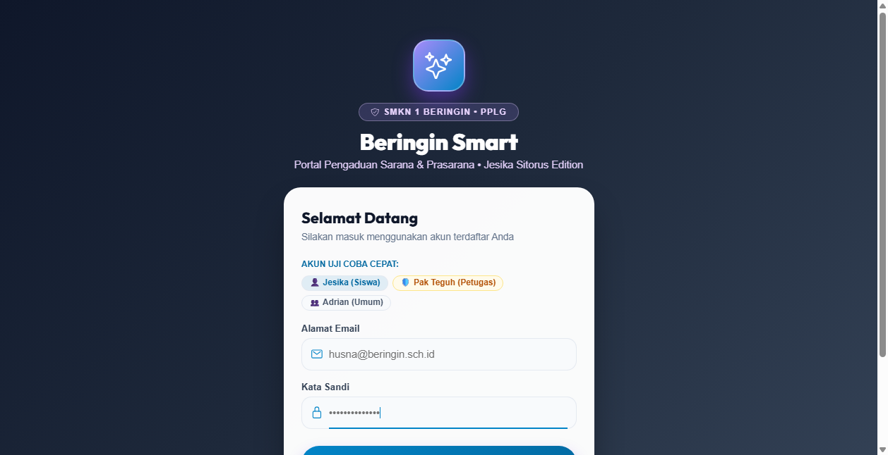
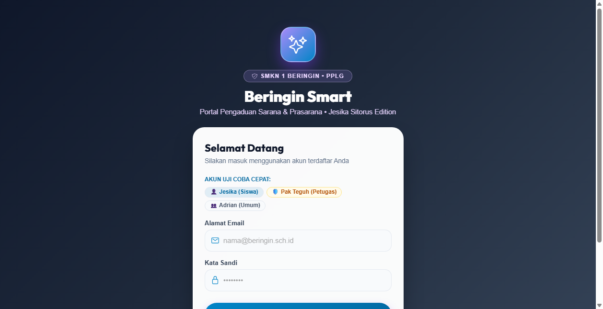

# Beringin Smart — Portal Pengaduan Sarana & Prasarana Sekolah
> **Edisi Khusus: Nurul Husna (XI PPLG 2)**  
> **SMK Negeri 1 Beringin • Tahun Ajaran 2026/2027**  
> Standar Kompetensi Kerja Nasional Indonesia (SKKNI) No. 282 Tahun 2016  
> Tema Identitas Antarmuka: **Forest Pine & Fresh Emerald Sage**

---

## 📌 Deskripsi Proyek
**Beringin Smart (Husna Edition)** adalah aplikasi layanan pelaporan kerusakan sarana dan prasarana lingkungan sekolah berbasis Mobile & Web responsif di SMK Negeri 1 Beringin. Aplikasi ini dirancang untuk mempermudah siswa melaporkan kendala fasilitas secara real-time dan transparan ke tim sarpras sekolah.

Arsitektur Teknologi:
- **Backend**: Laravel 11 RESTful API + Autentikasi Sanctum
- **Frontend**: React 18 + Ionic Framework v8 + TypeScript + Vite Bundler
- **Database**: MySQL 8.4 (Port 3306)
- **Tema Visual**: Nuansa elegan **Forest Pine & Fresh Emerald Sage**

---

## 👥 Hak Akses & Kredensial Uji Coba

| Peran (Role) | Nama Pengguna | Alamat Email | Kata Sandi |
|---|---|---|---|
| **Siswa Utama** | Nurul Husna | `husna@beringin.sch.id` | `password123` |
| **Petugas Sarpras** | Staf Pemeliharaan Sarpras | `petugas@beringin.sch.id` | `password123` |
| **Siswa Pendukung** | Siswa SMKN 1 Beringin | `siswa@beringin.sch.id` | `password123` |

---

## 📸 Dokumentasi & Bukti Pengujian Antarmuka (11 Screenshot)

### 1. Antarmuka Portal Masuk Pengguna (Login)


---

### 2. Validasi Keamanan (Error Handling Login Gagal)


---

### 3. Dashboard Beranda Siswa


---

### 4. Detail Laporan Sarpras (Tampilan Siswa)


---

### 5. Filter Penyaringan Kategori Sarpras


---

### 6. Formulir Tambah Pengaduan Kerusakan


---

### 7. Konfirmasi Tiket Baru Tersimpan


---

### 8. Dashboard Panel Petugas Sarpras


---

### 9. Panel Aksi Tindak Lanjut Petugas


---

### 10. Status Pekerjaan Selesai


---

### 11. Pengujian Antarmuka Smartphone (Mobile)


---

## 🚀 Panduan Menjalankan di Komputer Lokal

### 1. Menjalankan Backend API
```powershell
cd D:\Husna\beringin-backend
php artisan serve
```

### 2. Menjalankan Frontend
```powershell
cd D:\Husna\Beringin-Smart
npm run dev
```
Akses di browser: `http://localhost:5173`
