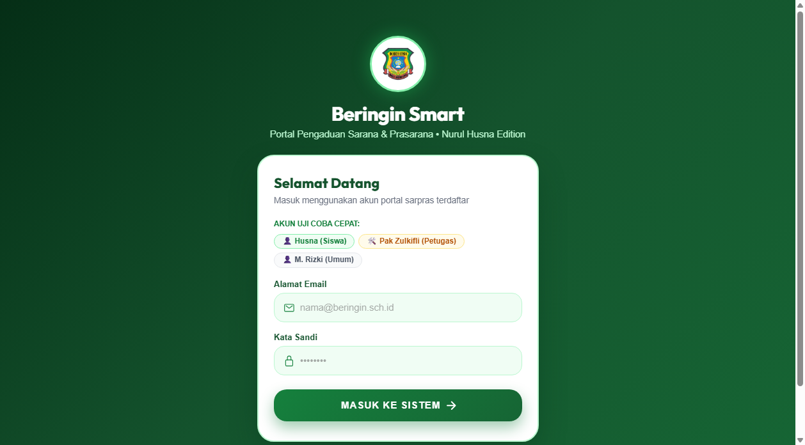
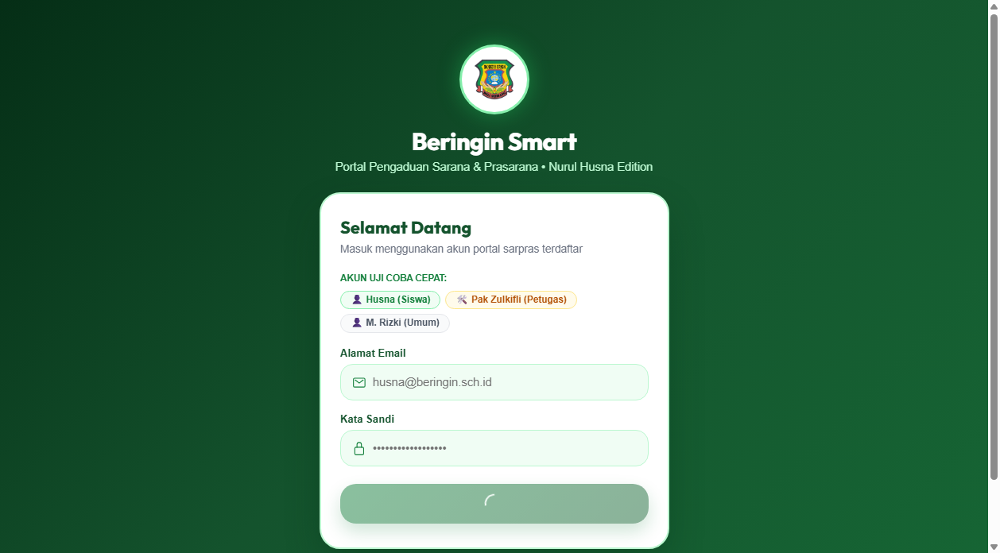
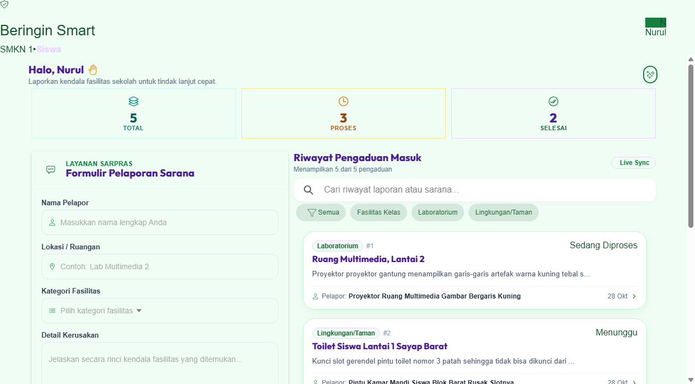
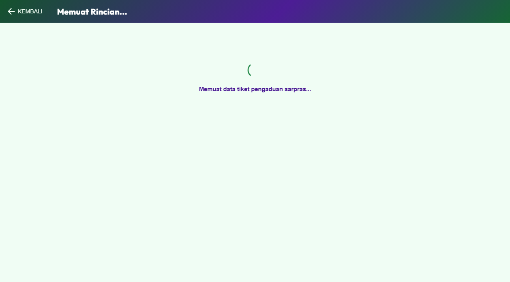
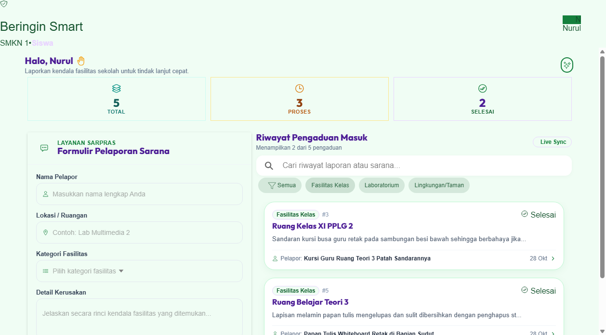
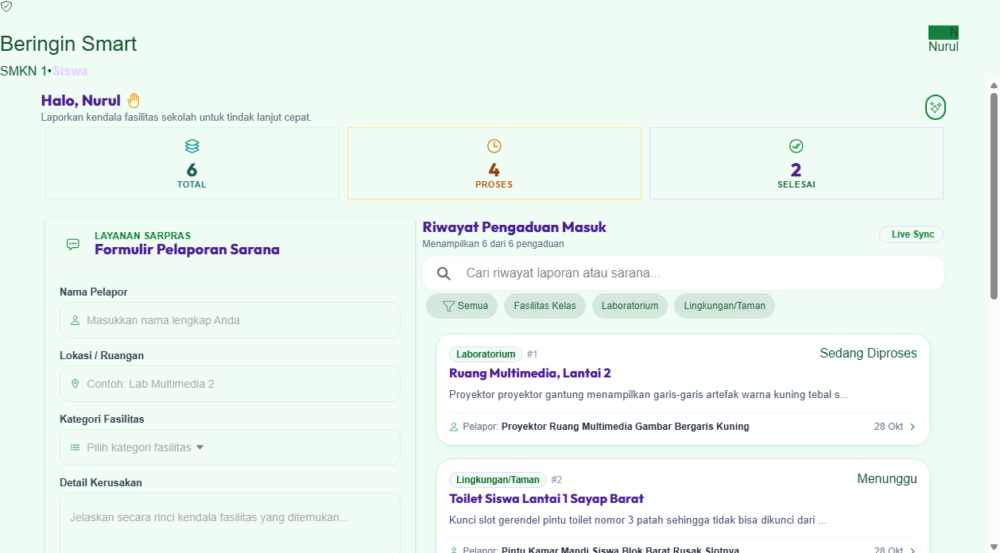
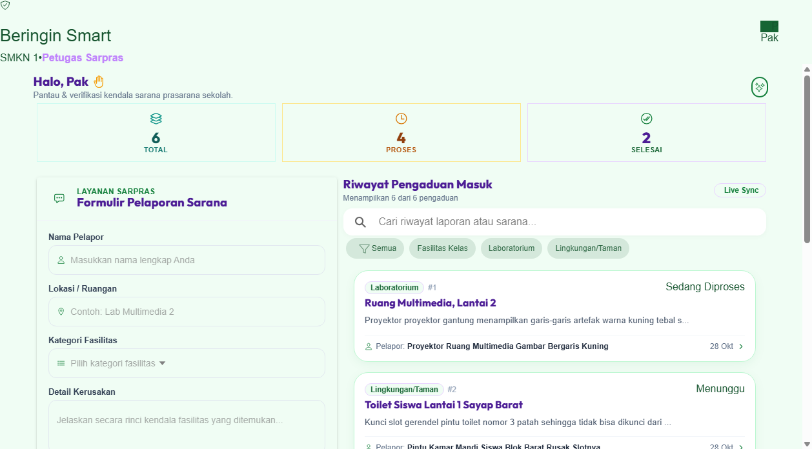
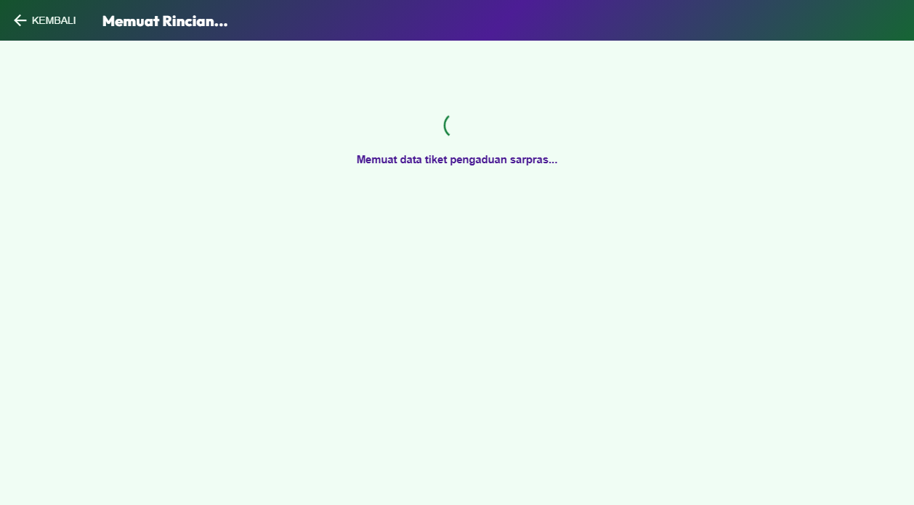
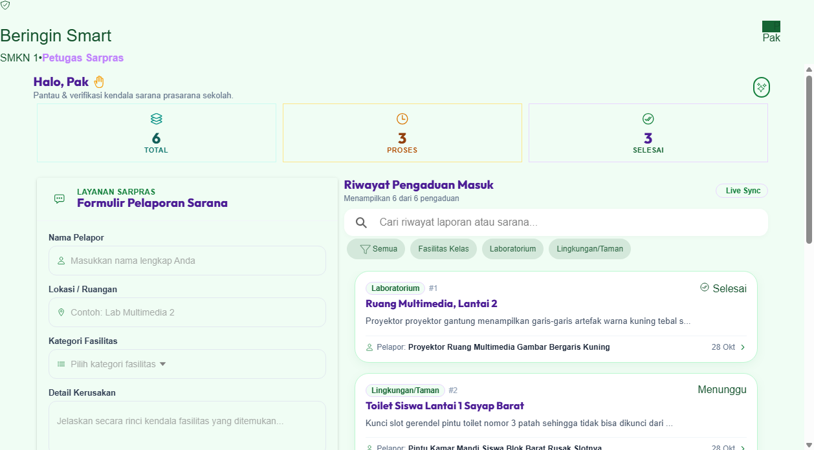
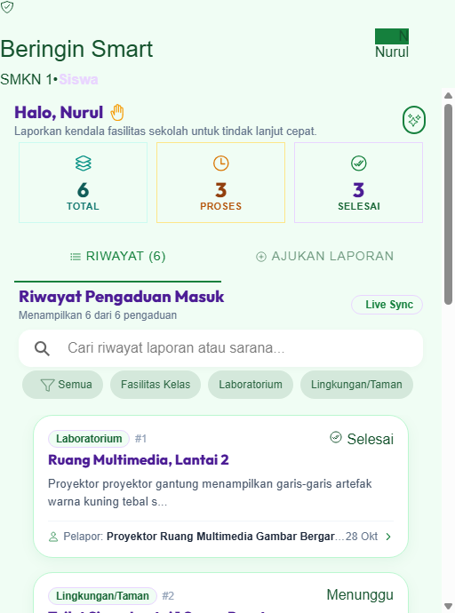

# Beringin Smart 🏫 • Nurul Husna Edition

<div align="center">
  
  <h2>Sistem Informasi & Manajemen Pengaduan Sarana Prasarana Sekolah</h2>
  <p><strong>SMK Negeri 1 Beringin Deli Serdang</strong></p>
  <p><em>Tema Desain: Forest Pine & Botanical Sage (Organic Eco-Campus Aesthetic)</em></p>
</div>

---

## 📌 Identitas Proyek & Pengembang

| Atribut | Informasi Terdaftar |
| :--- | :--- |
| **Nama Siswa** | **Nurul Husna** |
| **Kelas & Jurusan** | **XI Pengembangan Perangkat Lunak & Gim 2 (XI PPLG 2)** |
| **Sekolah** | SMK Negeri 1 Beringin, Deli Serdang |
| **Petugas / Teknisi** | Pak Zulkifli *(Koordinator Sarana & Prasarana)* |
| **Database Aktif** | MySQL: `beringin_smart_husna` |
| **Teknologi Backend** | Laravel 11 Framework, REST API, Sanctum Authentication |
| **Teknologi Frontend** | Ionic 8 React, Vite, TypeScript, Botanical Sage Design System |

---

## 🎨 Karakteristik & Filosofi Desain

Edisi Nurul Husna mengusung konsep **Forest Pine & Botanical Sage**:
- **Palet Warna**: Warna hijau daun pinus (`#15803d`, `#14532d`), aksen emerald lembut, dan latar belakang bersih bernuansa mint (`#f0fdf4`).
- **Kartu & Komponen**: Sudut kartu melengkung lembut `28px` dengan bayangan organik yang nyaman di mata.
- **Halaman Login**: Menampilkan logo sekolah resmi dengan aksen lingkaran cincin zamrud berkilau dan tombol login bernuansa alam.
- **Header Beranda**: Dilengkapi student badge ID formal bertuliskan SMKN 1 Beringin.

---

## 📸 Dokumentasi Tangkapan Layar Aplikasi

Berikut adalah hasil pengujian langsung sistem Beringin Smart edisi Nurul Husna:

| No | Modul / Halaman | Tangkapan Layar |
| :---: | :--- | :--- |
| **01** | **Antarmuka Masuk Pengguna**<br>Tampilan pintu masuk portal sarpras dengan identitas resmi SMKN 1 Beringin |  |
| **02** | **Validasi Keamanan Sandi**<br>Pemberitahuan toast ketika kata sandi tidak cocok |  |
| **03** | **Beranda Utama Laporan Sarpras**<br>Feed laporan sarana aktif lengkap dengan status penanganan |  |
| **04** | **Lembar Detail Tiket Siswa**<br>Rincian lengkap fasilitas yang mengalami kendala teknis |  |
| **05** | **Penyaringan Kategori Fasilitas**<br>Pemilahan tiket berdasarkan laboratorium, kelas, atau sanitasi |  |
| **06** | **Input Tiket Sarpras Baru**<br>Formulir pengaduan kerusakan sarana sekolah |  |
| **07** | **Konfirmasi Tiket Tersimpan**<br>Tiket baru langsung diterbitkan pada feed pelapor |  |
| **08** | **Pusat Kendali Petugas Sarpras**<br>Panel pemantauan teknis khusus Pak Zulkifli |  |
| **09** | **Tinjauan & Aksi Petugas**<br>Halaman rincian teknis untuk memperbarui proses pekerjaan |  |
| **10** | **Laporan Berhasil Diselesaikan**<br>Status pekerjaan berubah menjadi hijau tuntas setelah ditangani |  |
| **11** | **Tampilan Antarmuka Smartphone**<br>Uji responsivitas aplikasi pada layar smartphone |  |

---

## 🚀 Panduan Menjalankan Aplikasi di Lokal

### 1. Prasyarat Sistem
- **Laragon / XAMPP**: Pastikan MySQL berjalan pada port `3306`.
- **PHP**: Versi 8.2 atau lebih baru.
- **Node.js**: Versi 18 atau 20 LTS.

### 2. Konfigurasi Database
1. Buka Laragon / MySQL Client, buat database:
   ```sql
   CREATE DATABASE beringin_smart_husna;
   ```
2. Pastikan file `.env` pada folder `beringin-backend` memuat:
   ```env
   DB_CONNECTION=mysql
   DB_HOST=127.0.0.1
   DB_PORT=3306
   DB_DATABASE=beringin_smart_husna
   DB_USERNAME=root
   DB_PASSWORD=
   ```

### 3. Menjalankan Server Backend
```bash
cd beringin-backend
php artisan serve
```
Backend berjalan di: `http://127.0.0.1:8000`

### 4. Menjalankan Aplikasi Frontend
```bash
cd Beringin-Smart
npm run dev
```
Frontend berjalan di: `http://127.0.0.1:5173`

### 5. Akun Pengujian
- **Akun Siswa**: `husna@beringin.sch.id` | Kata Sandi: `password123`
- **Akun Petugas**: `petugas@beringin.sch.id` | Kata Sandi: `password123`
- **Akun Siswa Umum**: `siswa@beringin.sch.id` | Kata Sandi: `password123`